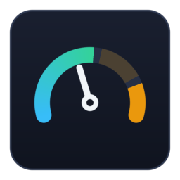
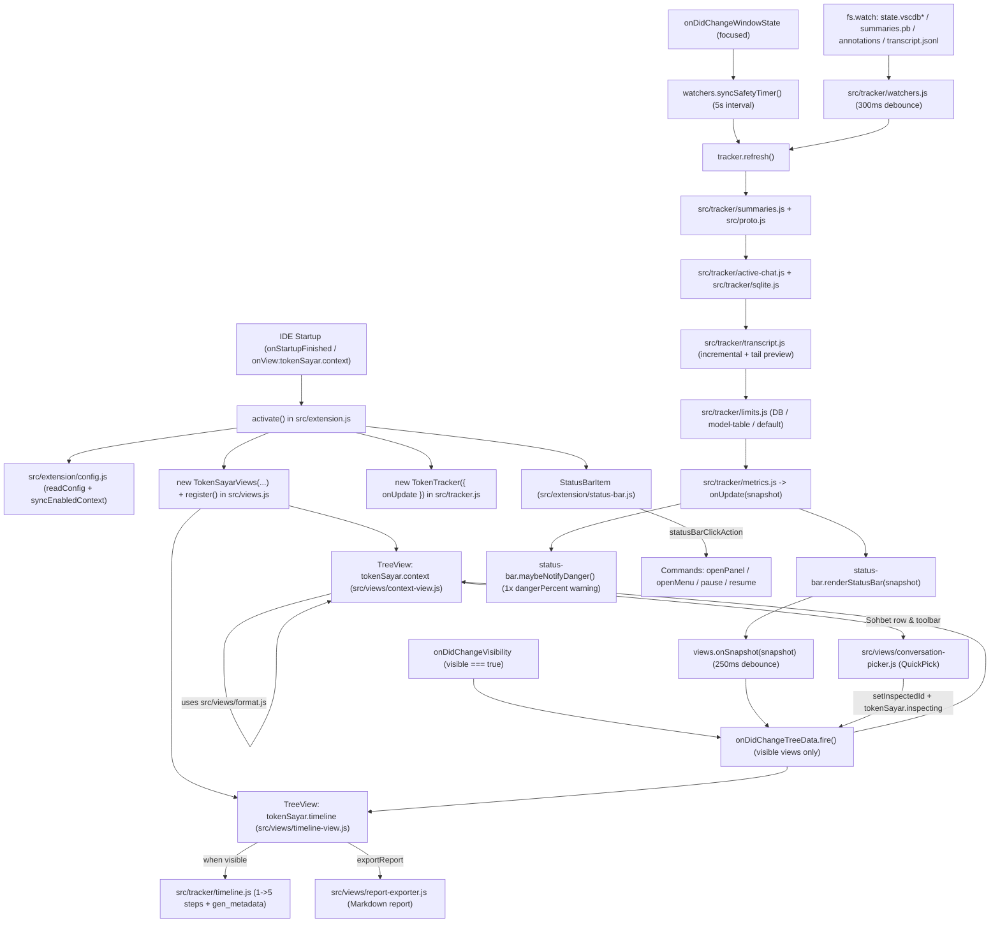

<p align="center">
  
</p>

# Token Sayar (Antigravity)

<p align="center">
  Antigravity ve VS Code sohbetleriniz için sıfır bağımlılıklı, salt-okunur canlı bağlam (context) token takip eklentisi.
</p>

<p align="center">
  
  
  
  
</p>

## Bu Uygulama Nedir ve Neden Var?

**Token Sayar**, Antigravity sohbetlerinin aktif bağlam (context) token kullanımını, doluluk yüzdesini, tahmini kalan mesaj sayısını ve mesaj bazlı token akışını durum çubuğunda (Status Bar) ve sol etkinlik çubuğundaki (Activity Bar) yerel TreeView görünümlerinde canlı gösteren, tamamen bağımsız ve sıfır dış bağımlılıklı yerel bir VS Code / Antigravity IDE eklentisidir.

**Neden yapıldı?**

- Antigravity, arayüzünde sohbetin o anki bağlam doluluğunu veya kendi belirlediği gerçek otomatik sıkıştırma (auto-compaction) bütçesini (`512K`, `256K`, `160K` vb.) canlı olarak göstermez.
- Uzun yapay zeka kodlama oturumlarında bağlam doluluğu **%55** civarına ulaştığında dikkat dağılması (*Context Rot*) başlar; **%80–92+** sonrasında ise ani ve kayıplı otomatik sıkıştırma kritik proje kurallarını veya eski adımları özetleyerek silebilir.
- Token Sayar, hiçbir IDE veya `google.google-antigravity` çekirdek dosyasına dokunmadan yerel veritabanlarını salt-okunur okuyarak geliştiricilere anlık görünürlük sağlar.
- Antigravity IDE (2.x), VS Code ve Antigravity (1.x) üzerinde aynı şekilde çalışır; takip duraklatıldığında tüm dosya izleyicileri ve zamanlayıcıları anında durdurarak arka plan yükü bırakmaz.

## Ne Yapar

Durum çubuğunun sağ tarafında aktif sohbetin canlı bağlam doluluğu gösterilir:

- `42,3K / 512K (%8)` — **Sağlıklı:** Bağlam rahat bölgede.
- `310K / 512K (%61)` — **Uyarı:** Bağlam dolmaya başladı; dikkat dağılması görülebilir.
- `438K / 512K (%86)` — **Dolu:** Sıkıştırma (`/compact`) veya yeni sohbet önerilir.
- `Token: Kapalı` — Takip duraklatıldı.

Durum çubuğunun üzerine gelindiğinde (hover) mevcut doluluk, kademe durumu, aktif model bilgisi ve kalan kapasite özet olarak görünür.

Bağlam doluluğu kırmızı eşiğe (`tokenSayar.dangerPercent`) ulaştığında ve `tokenSayar.notifications` açık olduğunda, her sohbet için en fazla bir kez **Görünümü Aç** düğmeli bir uyarı bildirimi gösterilir.

Durum çubuğuna tıklandığında varsayılan olarak (`tokenSayar.statusBarClickAction: "openPanel"`) sol etkinlik çubuğundaki **Token Sayar** görünümü açılır; ayarlardan hızlı işlem menüsü (`"openMenu"`) de seçilebilir.

## Sol Etkinlik Çubuğu Görünümleri (Activity Bar)

Sol etkinlik çubuğundaki **Token Sayar** simgesine tıklayarak (veya Komut Paletinden **`Token Sayar: Paneli Aç`** / **`Token Sayar: Mesaj Akışını Aç`** komutlarını çalıştırarak) iki yerel TreeView görünümüne ulaşabilirsiniz:

1. **Bağlam (`tokenSayar.context`):**
   - En üstteki tıklanabilir **`Sohbet`** seçici satırı (`Sohbet · Değiştir`) ile çalışma alanlarına göre ayrılmış QuickPick listesinden istediğiniz sohbete geçebilirsiniz; aktif olmayan bir sohbet inceleniyorken hemen altında **`Aktif sohbete dön`** satırı görünür.
   - **`Doluluk`** satırında 20 hücreli eşik işaretli doluluk çubuğu (`▰` dolu, `▱` boş, `│` sarı eşik, `┃` kırmızı eşik) ile birlikte aktif kullanım / tavan ve yüzde yer alır.
   - **`Durum`**, **`Kalan`** (kalan boş kapasite ve son mesajlardaki ortalama büyümeye göre tahmini kalan mesaj sayısı `~N mesaj`), **`Model`** (çoklu model kullanıldıysa açılır liste), **`Tur ve sıkıştırma`** ve açılır **`Ayrıntılar`** (`Son adım yeni girdi`, `Son adım önbellekten okunan`, `Son adım çıktısı`, `Oturum toplamı işlenen`, `Oturum toplam çıktı`, `Önbellek tasarruf oranı`, `Limit kaynağı`, `Son güncelleme`).
   - Her metrik satırının üzerinde native hover tooltip açıklaması yer alır; sağ tık veya satır içi **Değeri Kopyala** komutuyla değerler panoya kopyalanabilir.
   - Bağlam doluluğu `warnPercent` eşiğine ulaştığında görünüm rozeti (badge) yüzdeyi gösterir.
2. **Mesaj Akışı (`tokenSayar.timeline`):**
   - Yalnızca görünüm açıkken tembel yükleme (lazy loading) ile oluşturulur; kronolojik sırayla her kullanıcı mesajını listeler ve yalnızca son tur varsayılan olarak açık gelir. Birden fazla tur varsa en yüksek bağlam artışı/yüküne sahip tur turuncu alev simgesiyle işaretlenir.
   - Her mesajın altında beş kronolojik adım yer alır:
     1. **`1. Senin mesajın`**
     2. **`2. Modele okutulan bağlam (N adım)`** (açıldığında `Önbellekten tekrar okunan`, `İlk kez okunan yeni girdi`, `Adım başına ortalama okunan`)
     3. **`3. Model düşünmesi (geçici)`**
     4. **`4. Model yanıtı ve araç çağrıları`**
     5. **`5. Net bağlam değişimi (kalıcı)`** (açıldığında `Önceki bağlam`, `Eklenen kullanıcı mesajı`, `Eklenen araç çıktıları ve yanıtlar`, `Yeni aktif bağlam` ve `Adım adım bağlam ilerlemesi`)
   - Başlık çubuğundaki **Raporu Aç** (`tokenSayar.exportReport`) komutuyla sohbetin bağlam özeti, eşik tablosu ve mesaj akışı dökümü yeni bir Markdown belgesi olarak açılabilir.

### Görünüm Başlığı Araç Çubuğu ve Hoş Geldin Durumları

Görünüm başlık çubuğunda bağlama duyarlı işlemler yer alır:

- **Sohbet Seç...** (`tokenSayar.selectConversation`): Çalışma alanlarına göre ayrılmış QuickPick listesinden sohbet seçer veya aktif sohbete döner.
- **Aktif Sohbete Dön** (`tokenSayar.followActive`): Başka bir sohbet incelenirken (`tokenSayar.inspecting`) görünür; canlı sohbet takibine geri döner.
- **Yenile** (`tokenSayar.refresh`): Token verisini hemen yeniden okur.
- **Takibi Duraklat / Takibi Sürdür** (`tokenSayar.pause` / `tokenSayar.resume`): `tokenSayar.enabled` bağlamına göre tek tıkla izlemeyi durdurur veya başlatır.
- **Raporu Aç** (`tokenSayar.exportReport`): `Mesaj Akışı` araç çubuğunda (ve `Bağlam` taşma menüsünde) yer alır; seçili sohbetin Markdown raporunu açar.
- **Yardım** (`tokenSayar.showHelp`): Eklenti içindeki [media/help.md](media/help.md) rehberini Markdown önizlemesi olarak açar.
- **Ayarlar** (`tokenSayar.openSettings`): `tokenSayar` ayarlarını açar.

Takip duraklatıldığında `Bağlam` görünümünde `viewsWelcome` alanı üzerinden **Takibi Sürdür** bağlantısı gösterilir; henüz mesaj olmayan sohbetlerde `Mesaj Akışı` görünümü bilgilendirici boş durum metni gösterir.

## Kendi VS Code / Antigravity IDE'ne Nasıl Kurarsın? (Kurulum Rehberi)

### Ön Koşullar

- **Node.js:** `v22+` önerilir (yerleşik `node:sqlite` modülü ile Antigravity veritabanından gerçek sıkıştırma tavanını okumak için; eski sürümlerde model tablosu veya varsayılan tavan yedeği devreye girer).
- **IDE:** VS Code veya Antigravity IDE (2.x / 1.x).

### Yöntem 1: Tek Komutla Kurulum (Önerilen — Windows / macOS / Linux)

```bash
git clone https://github.com/<kullanici-adi>/token-sayar.git
cd token-sayar
npm run install-ext
```

İsteğe bağlı bayraklar:

- Yalnızca belirli bir IDE'ye kurmak için: `npm run install-ext -- --target=code` (veya `--target=antigravity-ide`)
- Eski Antigravity 1.x kurulumunu atlamak için: `npm run install-ext -- --skip-legacy`
- Windows PowerShell alternatifi:

```powershell
powershell -ExecutionPolicy Bypass -File .\scripts\install.ps1
```

### Yöntem 2: IDE Arayüzünden Kurulum (`Install from VSIX...` — CLI Gerekmez)

1. `npm run package` çalıştırarak `dist/token-sayar-1.4.1.vsix` dosyasını oluşturun (veya GitHub Releases sayfasından `.vsix` dosyasını indirin).
2. VS Code / Antigravity IDE içinde **Extensions** panelini açın (`Ctrl+Shift+X` / `Cmd+Shift+X`).
3. Sağ üstteki `...` (**Views and More Actions**) menüsüne tıklayın -> **Install from VSIX...** seçeneğini seçin.
4. `dist/token-sayar-1.4.1.vsix` dosyasını seçin.
5. Kurulum sonrası **`Ctrl+Shift+P` -> `Developer: Reload Window`** komutunu çalıştırın.

### Yöntem 3: Manuel CLI Kurulumu

Önce `npm run package` ile `.vsix` dosyasını üretin, ardından hedef IDE CLI'ı ile kurun:

```bash
code --install-extension dist/token-sayar-1.4.1.vsix --force
antigravity-ide --install-extension dist/token-sayar-1.4.1.vsix --force
```

> **Kurulum Sonrası Not:** Kurulum veya güncelleme sonrası yeni görünümlerin, eklenti logosunun ve başlık araç çubuklarının yüklenmesi için IDE içinde **`Ctrl+Shift+P` -> `Developer: Reload Window`** komutunu çalıştırın (veya IDE'yi kapatıp yeniden açın).

### Tek Komutla Kaldırma

Eklentiyi tüm kurulu IDE'lerden iz bırakmadan kaldırmak için:

```bash
npm run uninstall-ext
```

Windows PowerShell alternatifi:

```powershell
powershell -ExecutionPolicy Bypass -File .\scripts\uninstall.ps1
```

## Nasıl Açılır / Kapatılır

- `Bağlam` görünümü başlığındaki **Takibi Duraklat / Takibi Sürdür** düğmesini kullanın.
- Komut Paletinden (`Ctrl+Shift+P`) **`Token Sayar: Takibi Aç/Kapat`** komutunu çalıştırın.
- Hızlı işlem menüsünü kullanıyorsanız (`tokenSayar.statusBarClickAction: "openMenu"`), durum çubuğuna tıklayıp en üstteki **Takibi Duraklat** / **Takibi Sürdür** seçeneğini seçin. Aynı menüden **Token Sayar Görünümünü Aç**, **Mesaj Akışını Aç**, **Raporu Aç**, **Yenile**, **Sohbet Seç...**, **Özeti Kopyala** ve **Ayarlar** işlemlerine ulaşabilirsiniz.

## Ayarlar

| Ayar | Varsayılan | Açıklama |
| --- | --- | --- |
| `tokenSayar.enabled` | `true` | Eklentiyi açar veya kapatır. Kapalıyken tüm dosya izleyiciler ve zamanlayıcılar durdurulur. |
| `tokenSayar.warnPercent` | `55` | Sarı "Dolmaya başladı" uyarı eşiği (%). |
| `tokenSayar.dangerPercent` | `80` | Turuncu/kırmızı "Dolu" eşiği (%). |
| `tokenSayar.defaultContextLimit` | `512000` | Model limiti belirlenemediğinde kullanılacak varsayılan bağlam limiti (token). |
| `tokenSayar.compactDisplay` | `false` | Daha kısa durum çubuğu görünümü kullanır (`42,3K (%8)`). |
| `tokenSayar.statusBarClickAction` | `"openPanel"` | Durum çubuğuna tıklandığında Token Sayar görünümünü mü (`"openPanel"`) yoksa hızlı menüyü mü (`"openMenu"`) açacağını belirler. |
| `tokenSayar.notifications` | `true` | Bağlam doluluğu kırmızı eşiği geçtiğinde sohbet başına bir kez uyarı bildirimi gösterir. |
| `tokenSayar.modelLimits` | `{}` | İsteğe bağlı özel `model -> bağlam limiti` (token) eşleştirme nesnesi. |

---

## Ansiklopedik Rehber

Bu rehberin özet sürümüne eklenti içindeki `?` (**Yardım**) düğmesi üzerinden [media/help.md](media/help.md) dosyasından da ulaşabilirsiniz.

### `512K / 256K` Tavan Değerleri Nereden Geliyor ve Çoklu Model Nasıl İşleniyor

Birçok modelin tanıtım sayfasında "1M+ bağlam penceresi" yer alır. Ancak Token Sayar'da gördüğünüz **`512K`**, **`256K`**, **`160K`** veya **`128K`** tavan değerleri teorik reklam sınırları değildir:

- **Gerçek Otomatik Sıkıştırma (Auto-Compaction) Bütçesi:** Antigravity, her sohbet için yerel veritabanında (`conversations/<uuid>.db`) bir `executor_metadata` tablosu tutar ve her adımda `f10.f2.f5` protobuf alanına **o sohbeti otomatik olarak özetleyip sıkıştırmadan önce kullanabileceği gerçek bağlam bütçesini** yazar.
- Token Sayar bu `conversations/<uuid>.db` dosyasını salt-okunur (`readOnly`) okuyarak Antigravity'nin kendi belirlediği gerçek sıkıştırma tavanını gösterir.

Aynı sohbette birden fazla model kullanıldığında:

- Sohbet içinde model veya kademe değiştiğinde Antigravity her adım için `executor_metadata` tablosuna yeni bir satır (`idx`) yazar.
- Bir sonraki turda sıkıştırma gerekip gerekmediği **en son aktif adımın** bütçesine göre değerlendirildiği için Token Sayar daima **`ORDER BY idx DESC LIMIT 1`** sorgusuyla **en son aktif adımın tavan değerini** baz alır.
- Tur sayısı arttığında veya `.db` dosyasının değişiklik zamanı (`mtimeMs`) değiştiğinde önbellek otomatik yenilenir ve kullanılan tüm modeller (`modelsUsed`) `Model` düğümü altında listelenir.

### Parametreler Sözlüğü

| Parametre | Ne İfade Ediyor | Bize Ne Söylüyor |
| --- | --- | --- |
| **Doluluk (Aktif Bağlam)** | Yapay zekanın şu anki çalışma hafızasında tuttuğu toplam token (`Yeni Girdi + Önbellekten Okunan`). | 20 hücreli eşik çubuğu (`▰`/`▱`/`│`/`┃`) ile sohbetin şişip şişmediğini ve eşiklere mesafesini gösterir. |
| **Kalan (~N mesaj)** | Otomatik sıkıştırma tavanına kalan boş kapasite ve son mesajların ortalama kalıcı büyümesine göre kalan yaklaşık mesaj sayısı. | Yeni dosyalar, uzun kod blokları veya ek mesajlar için pratikte ne kadar yer kaldığını gösterir. |
| **Son adım yeni girdi** | Yalnızca son adımda modele sıfırdan eklenen taze token miktarı (yeni mesaj, dosya okuma, araç çıktısı). | Son adımın veya okutulan dosyanın bağlama tek seferde eklediği yükü gösterir. |
| **Son adım önbellekten okunan** | Önceki konuşma geçmişinden yeniden işlenmeden önbellekten okunan tokenlar. | Yüksek önbellek oranı yanıtı hızlandırır ve maliyeti düşürür; ancak aktif bağlam kotasını doldurmaya devam eder. |
| **Son adım çıktısı** | Modelin son adımda ürettiği yanıt ve düşünme tokenlarının toplamı. | Son adımın çıktı hacmini gösterir. |
| **Oturum toplamı işlenen / çıktı** | Sohbet başından beri kümülatif olarak işlenen girdi + önbellek toplamı ve toplam çıktı. | Her turda geçmiş yeniden okunduğu için aktif bağlamdan büyüktür; oturumun toplam token harcamasını gösterir. |
| **Önbellek tasarruf oranı** | Toplam okunan tokenlar içinde önbellekten karşılanan kısmın yüzdesi. | Önbellek verimliliğini ve yeniden hesaplama maliyetinden yapılan tasarrufu gösterir. |
| **Tur ve sıkıştırma** | Sohbette geçen toplam model adımı sayısı ve otomatik sıkıştırma sayısı. | Sıkıştırma sayısı arttıysa önceki ayrıntıların bir bölümü özetlenmiş demektir; kritik kuralları hatırlatmak gerekebilir. |
| **Limit kaynağı** | Kullanılan tavan değerin kaynağı (`Antigravity sohbet verisi`, `Model tablosu`, `Özel model ayarı` veya `Varsayılan ayar`). | Tavanın veritabanından mı yoksa yedek kuraldan mı geldiğini açıkça bildirir. |

### Bağlam Değişimi ile Okunan Tokenlar Arasındaki Fark ve Mesaj Akışı (1 -> 5)

Sadece 50 tokenlık kısa bir soru sorulduğunda dahi **Mesaj Akışı** görünümünde yüz binlerce veya milyonlarca token okunmuş görünmesinin nedeni, modelin tek bir mesaj turu içinde dosya okuma ve araç çağrıları için birden fazla adım çalıştırması ve her adımda tüm sohbet penceresini yeniden okumasıdır.

Somut bir 14 adımlı tur örneği üzerinden bakıldığında:

- **Önbellekten tekrar okunan**: `1,76M`
- **İlk kez okunan yeni girdi**: `348K`
- **Model düşünmesi (geçici)**: `10,5K`
- **Model yanıtı ve araç çağrıları**: `25,8K`
- **Net bağlam değişimi (kalıcı)**: `137,2K → 157,0K (+19,8K)`

Bu sayılar arasındaki ilişki şöyledir:

1. **Kümülatif okuma trafiği (`1,76M + 348K = 2,11M`):** 14 adımın her birinde yaklaşık `150K` boyutundaki konuşma penceresi modele tekrar okutulur (`14 × ~150K ≈ 2,11M`). Bu değer kalıcı pencere boyutunu değil, 14 adımın toplam okuma trafiğini gösterir.
2. **Geçici düşünme (`10,5K`):** Modelin iç akıl yürütme tokenları (`gen_metadata` `f1.f4.f9`) gelecek turların geçmişine eklenmez; yalnızca o anki yanıta ulaşmak için harcanır.
3. **Kalıcı bağlam büyümesi (`+19,8K`):** Tur tamamlandığında hafızada kalıcı olarak kalan yalnızca sizin mesajınız (`~456` token) ile gelecek turlara aktarılan araç çıktıları ve son yanıttır (`19,3K`): `137,2K + 456 + 19,3K = 157,0K`.

**Mesaj Akışı** her turu bu sıraya göre 5 adıma böler:

1. **`1. Senin mesajın`:** Yazdığınız metnin tahmini token sayısı (~4 karakter = 1 token).
2. **`2. Modele okutulan bağlam (N adım)`:** Tüm adımlardaki `Önbellekten tekrar okunan + İlk kez okunan yeni girdi` toplamı ve adım başına ortalama okunan miktar.
3. **`3. Model düşünmesi (geçici)`:** İç muhakeme tokenları (`gen_metadata` `f1.f4.f9`; ayrım bildirilmiyorsa `—`).
4. **`4. Model yanıtı ve araç çağrıları`:** Görünür metin ve araç çağrıları (`gen_metadata` `f1.f4.f10`).
5. **`5. Net bağlam değişimi (kalıcı)`:** `Önceki bağlam + Eklenen kullanıcı mesajı + Eklenen araç çıktıları ve yanıtlar = Yeni aktif bağlam` dökümü (veya sıkıştırma gerçekleştiyse `Sıkıştırıldı`), ayrıca her adımın `Adım adım bağlam ilerlemesi` listesi.

### Varsayılan Uyarı Eşikleri (`%55` Sarı, `%80` Turuncu, `%92+` Kırmızı)

Token Sayar'daki varsayılan **`%55`** ve **`%80`** eşikleri büyük dil modelleri ve kodlama ajanları üzerine yapılan araştırmalara ve geliştirici topluluğu bulgularına dayanır:

1. **Liu et al. (2023 / TACL 2024) — *"Lost in the Middle"*** ([arxiv.org/abs/2307.03172](https://arxiv.org/abs/2307.03172)): Uzun bağlamlarda modellerin U şeklinde bir dikkat eğrisine sahip olduğu, kritik bilgiler bağlamın ortasında kaldığında doğruluk oranının **%15–30+** düştüğü gösterilmiştir.
2. **Hsieh et al. / NVIDIA (2024) — *"RULER"*** ([arxiv.org/abs/2404.06654](https://arxiv.org/abs/2404.06654)): Çok adımlı muhakeme ve bilgi birleştirme görevlerinde modellerin etkin bağlam uzunluğunun ilan edilen teorik pencerenin (128K–1M) belirgin ölçüde altında kaldığı ortaya konmuştur.
3. **Chroma (2025) — *"Context Rot"*** ([research.trychroma.com/context-rot](https://research.trychroma.com/context-rot)): 18 model (GPT-4.1, Claude 4, Gemini 2.5, Qwen3) üzerinde yapılan testlerde güvenilirliğin %100 sınırında aniden değil token arttıkça **sürekli olarak bozulduğu**, konuşma görevlerinde dikkat dağıtıcılarla birlikte **~113K+ token** düzeyinde belirginleştiği ölçülmüştür.
4. **Anthropic (2025) — *"Effective Context Engineering for AI Agents"*** ([anthropic.com/engineering/effective-context-engineering-for-ai-agents](https://www.anthropic.com/engineering/effective-context-engineering-for-ai-agents)): Bağlamın sınırlı bir dikkat bütçesi olduğunu vurgular; sıkıştırma, yapılandırılmış not alma ve alt-ajan kullanımını önerir. Anthropic API otomatik sıkıştırma varsayılanı **150K token** düzeyindedir.
5. **Kodlama Ajanı Topluluğu Konsensüsü ("Smart Zone" vs "Dumb Zone"):** Geliştirici topluluklarında en yüksek kodlama keskinliğinin **< %35–40** aralığında olduğu, **~%50–55** civarında talimat sapması ve bağlam çürümesinin ("Context Rot") başladığı, **~%75–80** seviyesinin belirgin düşük verim bölgesi ("Dumb Zone") olduğu ve **>= %92** düzeyinde kayıplı otomatik sıkıştırma riskinin doğduğu kabul edilir.

Bu bulgulara göre Token Sayar şu kademeleri kullanır:

| Doluluk Oranı | Durum | Renk | Ne Yapmalı |
| --- | --- | --- | --- |
| **`< %55`** | Sağlıklı | Yeşil | Odak yüksek; normal şekilde devam edilebilir. |
| **`%55 – %79,9`** | Dolmaya başladı | Sarı (`warnPercent: 55`) | Dikkat dağılması ve eski adımları unutma başlayabilir (`256K` bütçede ~141K, `512K` bütçede ~282K). Yeni bir göreve geçmeden önce özetleme değerlendirilebilir. |
| **`%80 – %91,9`** | Dolu, sıkıştırma önerilir | Turuncu (`dangerPercent: 80`) | Belirgin verim düşüşü bölgesi (`256K` bütçede ~205K, `512K` bütçede ~410K). **`/compact`** çalıştırın veya yeni bir sohbet açın. |
| **`>= %92`** | Kritik, yeni sohbet önerilir | Kırmızı | Antigravity her an kayıplı otomatik sıkıştırma tetikleyebilir. Kritik kuralları kaybetmemek için yeni sohbete geçin. |

---

## Proje Mimarisi, Klasör Ağacı ve Tetikleme Haritası

### 1. Klasör ve Dosya Yapısı

```text
token-sayar/
├── .github/
│   └── workflows/
│       └── ci.yml                    # GitHub Actions CI (test ve paket doğrulaması)
├── .gitignore                        # Git yoksayma kuralları (dist/, node_modules/ vb.)
├── LICENSE                           # MIT Lisansı
├── package.json                      # Eklenti manifesti (v1.4.1), logo, 2 TreeView, viewsWelcome, menüler ve 8 ayar
├── README.md                         # Kullanım kılavuzu, kurulum rehberi ve mimari dokümantasyon
├── media/
│   ├── icon.svg                      # Sol Activity Bar monokrom eklenti ikonu
│   ├── logo.png                      # Eklentiler listesi ve detay sayfası logosu (256x256 PNG)
│   └── help.md                       # Yardım (?) komutu ile açılan yerleşik rehber
├── src/
│   ├── extension.js                  # Eklenti giriş noktası (activate/deactivate), komut kayıtları ve yaşam döngüsü
│   ├── extension/
│   │   ├── config.js                 # readConfig, configsEqual, getWorkspaceFolderPaths, syncEnabledContext
│   │   └── status-bar.js             # renderStatusBar, buildTooltip, buildClipboardSummary, maybeNotifyDanger, showQuickMenu
│   ├── views.js                      # TokenSayarViews orkestratörü, VIEW_IDS, 250 ms debounce ve görünüm komutları
│   ├── views/
│   │   ├── format.js                 # Ortak Türkçe biçimlendirme, TIER_MAP, buildThresholdBar, makeTreeItem, mapStatusLabel
│   │   ├── context-view.js           # tokenSayar.context TreeView oluşturucu (buildContextChildren, buildDetailChildren)
│   │   ├── timeline-view.js          # tokenSayar.timeline TreeView ve normalizeTurnStepMetrics
│   │   ├── conversation-picker.js    # Çalışma alanına göre gruplanmış QuickPick sohbet seçici (showConversationPicker)
│   │   └── report-exporter.js        # Markdown rapor üretici ve açıcı (buildMarkdownReport, exportConversationReport)
│   ├── tracker.js                    # TokenTracker orkestratörü: durum yönetimi, public API ve alt modül koordinasyonu
│   ├── tracker/
│   │   ├── metrics.js                # Saf hesaplamalar: DEFAULT_MODEL_LIMITS, formatTokenCount, getEfficiencyStatus, computeCapacityMetrics
│   │   ├── sqlite.js                 # Salt-okunur node:sqlite sorguları (state.vscdb ve conversations/<uuid>.db)
│   │   ├── summaries.js              # agyhub_summaries_proto.pb ve annotations/*.pbtxt okuyucu
│   │   ├── active-chat.js            # Çalışma alanı eşleşmesi ve zaman damgasıyla aktif sohbet tespiti
│   │   ├── transcript.js             # Artımlı transcript.jsonl ve CHECKPOINT okuyucu + kuyruk önizleme tarayıcı
│   │   ├── limits.js                 # DB, model tablosu, özel ayar ve varsayılan tavan çözümleyici
│   │   ├── timeline.js               # Mesaj Akışı (1->5 adım) ve adım ilerlemesi oluşturucu (buildMessageTimeline)
│   │   └── watchers.js               # fs.watch izleyici yönetimi, 300 ms debounce ve 5 sn güvenlik zamanlayıcısı
│   └── proto.js                      # Sıfır bağımlılıklı protobuf wire decoder ve Antigravity ikili/pbtxt parser'ları
├── scripts/
│   ├── package-vsix.js               # collectSourceFiles ile tüm src/**/*.js dosyalarını VSIX içine paketleyen ZIP/manifest üreticisi
│   ├── install.js                    # Çapraz platform VSIX kurulum betiği (Windows / macOS / Linux)
│   ├── uninstall.js                  # Çapraz platform VSIX kaldırma betiği
│   ├── install.ps1                   # Windows PowerShell VSIX kurulum betiği
│   └── uninstall.ps1                 # Windows PowerShell VSIX kaldırma betiği
├── test/
│   ├── tracker.test.js               # Protobuf, artımlı transcript, DB limit çözümü, watcher ve entegrasyon testleri
│   └── modules.test.js               # Modüler alt bileşen birim testleri, sıfır-emoji hijyeni ve VSIX paket tamlığı testleri
└── dist/                             # (Üretilen çıktı) package-vsix.js tarafından oluşturulan .vsix paketi
```

### 2. Dosya Sorumlulukları ve Veri Kaynakları ("Ne Nereden Geliyor?")

- **`package.json`**: `local.token-sayar` kimliği (`v1.4.1`, `"icon": "media/logo.png"`), `onStartupFinished` ve `onView:tokenSayar.context` aktivasyon olayları, `viewsContainers.activitybar` (`token-sayar-sidebar`) altında 2 yerel TreeView (`tokenSayar.context`, `tokenSayar.timeline`), `viewsWelcome` boş/duraklatılmış durum içerikleri, `view/title` ve `view/item/context` menüleri ve 8 `tokenSayar.*` ayarı.
- **`src/extension.js` ve `src/extension/*`**:
  - `src/extension.js`: `activate(context)` ve `deactivate()` yaşam döngüsü; `StatusBarItem`, `TokenTracker`, `TokenSayarViews`, pencere/çalışma alanı/ayar dinleyicileri ve komut kayıtları (`pause`, `resume`, `toggle`, `refresh`, `openSettings`, `openMenu`, `statusBarClick`).
  - `src/extension/config.js`: `readConfig()`, `configsEqual(a, b)`, `getWorkspaceFolderPaths()`, `syncEnabledContext(enabled)` (`tokenSayar.enabled` context anahtarını senkronlar).
  - `src/extension/status-bar.js`: `renderStatusBar()`, `buildTooltip()`, `buildClipboardSummary()`, `maybeNotifyDanger()` (sohbet başına tek `showWarningMessage`), `showQuickMenu()`.
- **`src/views.js` ve `src/views/*`**:
  - `src/views.js`: `TokenSayarViews`, `VIEW_IDS` (`tokenSayar.context`, `tokenSayar.timeline`) ve `buildThresholdBar` (re-export). `250 ms` snapshot debounce, `onDidChangeVisibility`, `tokenSayar.inspecting` bağlamı ve görünüm komutlarını (`selectConversation`, `followActive`, `inspectConversation`, `copyValue`, `showHelp`, `openPanel`, `openTimeline`, `pinToStatusBar`, `unpinStatusBar`, `exportReport`) yönetir.
  - `src/views/format.js`: `TIER_MAP`, `LIMIT_SOURCE_LABELS`, `getTierInfo`, `getTierLabel`, `safeFormatTokens`, `trTokens`, `trDecimal`, `trRawInt`, `truncateText`, `formatClockHMS`, `formatClockHM`, `formatRelativeTime`, `buildThresholdBar`, `makeMarkdownTooltip`, `makeTextTooltip`, `makeTreeItem`, `extractConversationId`, `escapeMarkdown`, `mapStatusLabel`, `resolveConversationTitle`.
  - `src/views/context-view.js`: `buildContextChildren(ctx, element)` ve `buildDetailChildren(...)` — `Sohbet`, `Aktif sohbete dön`, `Doluluk`, `Durum`, `Kalan`, `Model`, `Tur ve sıkıştırma` ve `Ayrıntılar` dallarını üretir; `_contextView.description`, `message` ve `badge` alanlarını günceller.
  - `src/views/timeline-view.js`: `buildTimelineChildren(ctx, element)` ve `normalizeTurnStepMetrics(turn)` — yalnızca `Mesaj Akışı` görünümü açıkken turları, alev vurgusunu, 5 kronolojik adımı ve adım ilerlemesini oluşturur.
  - `src/views/conversation-picker.js`: `showConversationPicker(ctx)` — mevcut ve diğer çalışma alanlarına göre gruplanmış QuickPick listesini sunar.
  - `src/views/report-exporter.js`: `buildMarkdownReport(snapshot, timeline, config, options)` ve `exportConversationReport(ctx)` — sohbetin Markdown raporunu üretip yeni bir editör sekmesinde açar.
- **`src/tracker.js`, `src/tracker/*` ve `src/proto.js` (Veri Kaynağı Haritası)**:
  - **`src/tracker.js`**: `TokenTracker` sınıfı (`start`, `stop`, `setWindowFocused`, `updateConfig`, `updateWorkspaceFolders`, `setPinnedConversation`, `getSnapshot`, `listConversations`, `inspectConversation`, `getMessageTimeline`, `refresh`, `dispose`) ve `DEFAULT_MODEL_LIMITS`, `formatTokenCount`, `getEfficiencyStatus` re-export'ları.
  - **`src/tracker/summaries.js` <- `agyhub_summaries_proto.pb` ve `annotations/*.pbtxt`**: `loadSummariesWithAnnotations()`, `loadSummariesProto()`, `loadAnnotations()`, `isSubagentSummary()` — Antigravity'nin sohbet listesini, başlıklarını, çalışma alanı yollarını ve alt-ajan filtrelemesini `src/proto.js` (`parseSummariesProto`, `parseAnnotationPbtxt`) ile çözer.
  - **`src/tracker/sqlite.js` <- `state.vscdb` ve `conversations/<uuid>.db`**: `readWorkspaceLastConversationId()` ve `readGlobalAuxPaneConversationIds()` çalışma alanı/pencere `state.vscdb` dosyalarından son aktif sohbet ID'lerini okur. `queryConversationDbMetadata()` (`ORDER BY idx DESC LIMIT 1`) ve `queryGenMetadataUsage()` ise `conversations/<uuid>.db` içindeki `executor_metadata` ve `gen_metadata` tablolarından gerçek sıkıştırma tavanını (`f10.f2.f5`), model adını (`f1.f21`) ve düşünme/çıktı ayrımını (`f1.f4`) salt-okunur (`node:sqlite`) okur.
  - **`src/tracker/active-chat.js`**: `detectActiveConversationId()`, `normalizeWorkspaceFolders()`, `normalizePathForCompare()` — `summaries.pb`, çalışma alanı `state.vscdb` ve `auxPane` verilerini `VIEW_OVERRIDE_MARGIN_MS` / `STATE_DB_FLUSH_GRACE_MS` eşikleriyle birleştirip aktif sohbeti belirler.
  - **`src/tracker/transcript.js` <- `conversations/<uuid>/transcript.jsonl`**: `readTranscriptIncremental()`, `readTranscriptIntoState()`, `processTranscriptLine()`, `applyTranscriptRecord()`, `readTranscriptTailPreview()`, `scanTranscriptTail()` — satır içi artımlı okuma yaparak son bağlam tokenlarını, `CHECKPOINT` / sıkıştırma sayısını, tur sayısını ve `USER_INPUT` sınırları arasındaki pozitif bağlam artışını hesaplar.
  - **`src/tracker/limits.js`**: `resolveContextLimitAndDisplayName()`, `resolvePreviewLimitAndDisplayName()` — öncelik sırasıyla `conversations/<uuid>.db` tavanı (`db`), kullanıcı `modelLimits` / `DEFAULT_MODEL_LIMITS` (`model-table`) ve `defaultContextLimit` (`default`) kaynağını çözer.
  - **`src/tracker/metrics.js`**: `formatTokenCount`, `getEfficiencyStatus`, `matchModelLimit`, `normalizeConfig`, `buildEmptySnapshot`, `computeBloatLevel`, `computeCapacityMetrics`, `mergeModelsUsed` — doluluk yüzdesi, kademe durumu ve tahmini kalan mesaj (`estimatedRemainingMessages`) hesaplamaları.
  - **`src/tracker/timeline.js`**: `buildMessageTimeline()` — `transcript.jsonl` adımlarını `gen_metadata` düşünme/yanıt verileriyle eşleştirip her kullanıcı mesajı için 5 adımlık dökümü üretir.
  - **`src/tracker/watchers.js`**: `attachStaticWatchers()`, `ensureTranscriptWatcher()`, `scheduleRefresh()` (`300 ms` debounce), `syncSafetyTimer()` (pencere odaktayken `5 sn` güvenlik taraması).
  - **`src/proto.js`**: Sıfır bağımlılıklı protobuf wire decoder (`readVarint`, `decodeFields`, `parseTimestampMs`, `uriToFsPath`) ve Antigravity ikili/metin parser'ları.
- **`scripts/package-vsix.js`, `install.ps1`, `uninstall.ps1`**: `collectSourceFiles('src')` ile tüm `src/**/*.js` modüllerini, `media/help.md`, `media/logo.png` ve `package.json` dosyalarını `.vsix` içine paketler ve kurar/kaldırır.
- **`test/tracker.test.js` ve `test/modules.test.js`**: Çekirdek izleyici entegrasyon testleri ile modül birim testleri, sıfır-emoji hijyeni ve VSIX paket tamlığı doğrulamaları.

### 3. Tetiklenme ve Çalışma Zinciri

1. **IDE Açılışı (`onStartupFinished` / `onView:tokenSayar.context`)**:
   - `src/extension.js` -> `activate(context)` -> `config.readConfig()` -> `config.syncEnabledContext()` -> `StatusBarItem` oluşturulur -> `new TokenTracker({ onUpdate })` -> `new TokenSayarViews(...)` + `views.register()`.
   - `currentConfig.enabled === true` ise `tracker.start()` (`watchers.attachStaticWatchers()` + `watchers.syncSafetyTimer()` + `refresh(true)`) çalışır; `status-bar.renderStatusBar()` ve `views.onSnapshot()` ilk durumu günceller.
2. **Dosya Değişikliği -> Canlı Güncelleme Akışı**:
   - `watchers.js` hedefleri: `state.vscdb*`, `agyhub_summaries_proto.pb`, `annotations/*.pbtxt` ve aktif sohbetin `transcript.jsonl` dosyası.
   - Değişiklik -> `scheduleRefresh()` (`300 ms` debounce) -> `tracker.refresh(false)`:
     1. `summaries.loadSummariesWithAnnotations()`
     2. Sabitli değilse `active-chat.detectActiveConversationId()`
     3. `watchers.ensureTranscriptWatcher()` + `transcript.readTranscriptIncremental()`
     4. `limits.resolveContextLimitAndDisplayName()` (`sqlite.queryConversationDbMetadata()` ile `mtimeMs`/`turnCount` kontrolü)
     5. `metrics.computeCapacityMetrics()` + `_emitUpdate()` -> `onUpdate(snapshot)`
   - `onUpdate(snapshot)` -> `status-bar.renderStatusBar()` -> `status-bar.maybeNotifyDanger()` -> `views.onSnapshot(snapshot)` (`250 ms` debounce) -> yalnızca `visible === true` olan TreeView'lar `context-view.buildContextChildren()` / `timeline-view.buildTimelineChildren()` ile dalları çizer.
3. **Kullanıcı Etkileşimi**:
   - **StatusBar Tıklaması**: `statusBarClickAction === "openPanel"` ise `tokenSayar.context.focus`; `"openMenu"` ise `status-bar.showQuickMenu()`.
   - **TreeView Komutları**: `selectConversation` (`conversation-picker.showConversationPicker()`), `followActive`, `exportReport` (`report-exporter.exportConversationReport()`), `copyValue`, `showHelp` (`media/help.md`), `pause` / `resume` / `toggle`.

### 4. Mimari Akış Diyagramı (Mermaid)



---

## Geliştirme ve Test

Tüm birim ve entegrasyon testlerini (sıfır-emoji hijyeni ve VSIX paket tamlığı dahil) çalıştırmak için:

```bash
npm test
```

`.vsix` kurulum paketini (`dist/token-sayar-1.4.1.vsix`) üretmek için:

```bash
npm run package
```

## Lisans

Bu proje [MIT](LICENSE) lisansı ile lisanslanmıştır.
